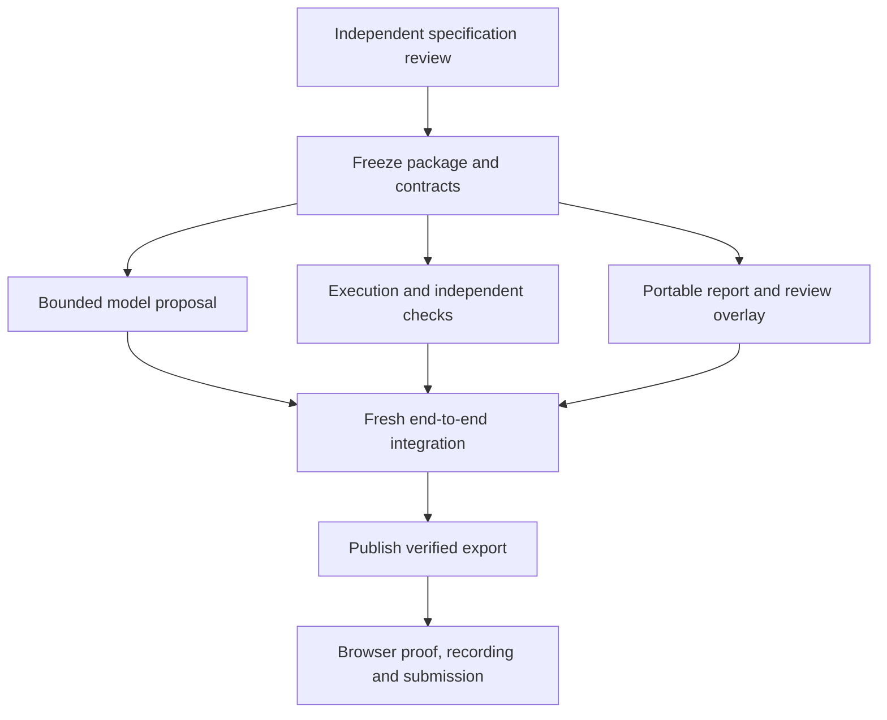

# QRef: review and implementation plan

Status: planning only. Implement [SPEC.md](SPEC.md) after the independent review in [REVIEW.md](REVIEW.md) and explicit implementation authorization. The user approved this direction and repository cleanup, not an already built application.

## Read in this order

1. `REVIEW.md` when reviewing; `SPEC.md` is the complete behavior contract.
2. `PRODUCT.md` for confirmed purpose/constraints; `CONTEXT.md` for exact domain terms.
3. `docs/design/report-brief.md` for the proposed public surface.
4. `docs/reviews/planning-verification.md` for actual proof and unverified branches.
5. This file for ownership, dependency order and closure criteria.

Do not restart market discovery, implement Ledger, copy its archived task queue, or turn the project into a hosted notebook executor. The old source is historical evidence only.

## Definition of done

A supported inspected migration goes from a real AI proposal through explicit local trust, two isolated executions, independent checks, a human-review input and a portable report. A real curated export is publicly accessible, reproducible and accurately described in a two-minute recording.

A static attractive page without the local run is incomplete. A CLI without the report/public presentation is incomplete. A report with fabricated execution, missing coverage or mislabeled replay is unacceptable.

The following proposed commands must exist and pass their behavior criteria at release: `qref propose`, `qref run`, `qref report`, `qref verify-bundle`. They do not exist today. No `make test` or `make verify` implementation is implied by old archive files.

### Half-day constraint

The user has roughly half a day for the build. This package does **not** establish a completion-time guarantee. The critical path is the dependency graph below; only proposal, execution and report work can overlap after one contract freeze. No new paid service or broad migration framework is permitted. Gate A must explicitly assess whether the complete path fits the actual remaining window. If it does not, implementation stays blocked until the owner chooses an explicit scope or schedule change; no agent silently skips gates, ships placeholders or claims the full release is done. All current acceptance criteria remain in force.

## Gates and dependencies

One integration owner owns schema changes, the final case, packaging, status aggregation and release claims. After the contract gate, proposal, execution and report work can proceed independently. They share the frozen schema—not ad hoc dictionaries or guessed defaults.

During a shared edit wave, agents skip concurrent builds, tests, lint and formatters. Once the wave settles, the integration owner runs the specific checks and actual changed paths. A task closes only after that evidence, not merely an agent's report of completion.

## Gate A — Review before implementation

**Owner:** a fresh reviewing AI, not the implementer reviewing its own assumptions.

**Inputs:** SPEC, PRODUCT, CONTEXT, report brief/schematic and planning verification. The review prompt is ready in REVIEW.md.

**Output:** prioritized findings with file/section references, affected user behavior, evidence, recommended resolution and a disposition. Distinguish a real blocker from an optional improvement. Explicitly test the no-paid-services promise, local trust model, actual-circuit capture, reference-not-truth semantics, coverage inventory, review binding and static deployment.

**Closure:** no unresolved blocker to the complete bounded workflow, and an explicit assessment of the half-day critical path. Changed interfaces are integrated into SPEC and PLAN before code starts. Unknown capabilities remain acceptance requirements, not results. The owner separately authorizes implementation; a reviewer cannot authorize an unannounced scope cut or deadline extension.

## Gate B — Package and freeze the contracts

**Ownership:** one contract/integration owner. This gate must land before parallel implementation.

**Files to create:** `pyproject.toml`, actual `uv.lock`, `.python-version`, `src/qref/`, packaged `protocol.schema.json`, `cases/qaoa.json`, focused protocol tests. Use a normal installable src-layout project and standard build backend. Include schemas, template, CSS and JS as package data; do not rely on cwd paths.

**Required behavior:**

- Base install supports validation/rendering without importing quantum libraries.
- Optional `quantum` dependencies match the exercised target pins. Reference setup remains separate.
- One Draft 7 schema source defines records. Explicit semantic validation covers duplicate JSON keys, finite values, exact hashes, graph/input bounds, UTC dates, cross-references and complete check inventories.
- Construct graphs from declared nodes before edges; isolated nodes must not disappear.
- Expected execution/check IDs exist even when a worker never completes.
- Human decisions bind exact evidence bytes. Pending template data is not approval.
- Exit-code and status rules match SPEC. No global scientific `passed` field.
- Provide schema-valid synthetic complete, partial and unsupported evidence fixtures so report work can proceed independently. Label their origin; they are contract examples, never real execution claims. Include source receipts, exact hash scopes, error codes and decision-state mappings.

**Acceptance:** meaningful positive/negative contract examples validate as intended, including a missing required check, mismatched digest, boolean shots, non-finite angle, duplicate ID, stale proposal and unknown schema. Renderer/protocol import works in a base-only environment. Required packaged assets survive installation. Do not add tests that merely pin field order, copy configuration or assert output is nonempty.

**Deliverable:** a coherent frozen contract and installable project. Do not mark the final CLI complete merely because help text or placeholders exist. Functional commands close in their own gates.

## Gate C — Real bounded proposal generation

**Files:** `proposal.py`, the `propose` command route, fixed prompt/schema and focused validation behavior.

**Interface:** `qref propose --case CASE --out NEW_DIRECTORY`.

**Required behavior:**

1. Read and validate the reference/case and pins, then copy input bytes.
2. Exercise the same-environment `claude auth status` guard and exact accepted fields from SPEC; reject billing/provider overrides. Do not print account identity or secrets.
3. Use the restricted no-tools temporary-cwd route and 180-second deadline from SPEC. Do not use bare mode or a shell.
4. Require successful structured output and valid Python syntax. The model executes no code; QRef preserves exact generated source bytes.
5. Write a portable case, licence/source receipts, pins and bound proposal artifacts. Publish `case.json` last; never turn an interrupted/error checkpoint into a runnable success.
6. Use the specified proposal-error record for refusal, auth failure, missing output, invalid syntax, timeout or write failure. No silent replay or repair loop.

**Acceptance:** perform one actual permitted CLI proposal, inspect the generated code and verify hashes/metadata. Use throwaway real calls for provider integration; permanent tests must focus on meaningful response rejection, stale attribution and no execution before trust—not a mocked provider echo. Preserve the difference between CLI invocation count and SDK/API turns.

**Do not add:** agent tools, arbitrary repository checkout, a provider factory, a paid API backend, browser keys or autonomous retries.

## Gate D — Execute the actual experiment and compare it

**Files:** `execution.py`, private standalone worker, `checks.py`, case/observation integration and behavior fixtures.

**Interface:** `qref run --case CASE --reference-python PY --target-python PY --out NEW_DIRECTORY --trust-local-code`.

**Required behavior:**

- Validate interpreter/package identities before candidate import. Execute copied snapshots through argv-list subprocesses and isolated Python mode.
- Keep the observer standalone so the old environment needs no modern QRef dependencies.
- Install the scoped Aer class hook before import. Require one actual submission/result per declared invocation. Handle renamed closures; record import-time or unsupported execution explicitly.
- Capture actual submitted QPY/metadata and checker QASM, measurement maps, histograms, returned values and module basis behavior. No separately rebuilt circuit may stand in for the sampled execution.
- Keep the independent negative-cut oracle in the comparison module, separate from candidate helpers. Compare returned values against the same captured counts, not another stochastic run.
- Deduplicate QCEC work only for identical paired bytes/configuration within the run. Populate every expected logical check slot even when prerequisites fail.
- Preserve unsupported, inconclusive, error and difference outcomes. No substring matching for enum success.
- Use the specified outer deadlines/checker budget and atomic observations. Terminate/reap expired children; no automatic retry.
- Save immutable evidence, artifacts and a pending review template through the frozen contract. Gate D does not depend on Gate E's renderer; first real run-to-report integration belongs to Gate F.

**Acceptance:** fresh seed run, identical-modern positive control, eight-qubit supported example, isolated-node case, one/two-layer inputs, seeded rotation and decoder changes, shot-policy difference, unsupported map/control/extra-run path, missing runtime, deadline and pairing faults. The positive planning probe is a reference for mechanics, not production code to copy without adding these semantics.

A seeded regression is evidence about a check, not a discovered model defect. An incomplete report must retain known differences. The old reference's ignored shot request must not become a claim that the target is wrong.

## Gate E — Report, review decisions and portable export

**Files:** `report.py`, packaged HTML/CSS/JS, review/manifest validation and meaningful export tests.

**Interfaces:** `qref report --run RUN [--decisions FILE] --out NEW_DIRECTORY`; `qref verify-bundle --run DIRECTORY`.

**Required behavior:**

- Verify input bundle content before rendering. Base rendering imports no quantum package and never imports a candidate.
- Render all core facts, limits and provenance as HTML. JavaScript enhances downloads/copy only; no live job or approval simulation.
- Use the finding-first patch-review design. Lead with the actual change and include human state plus coverage beside the result.
- Show model disclosure separately from execution and human judgment. If the prompt supplied the shot correction, say so; do not imply autonomous discovery. Never prefill a real person's acceptance.
- Keep the shot table, unique circuit results, per-execution evidence, source hunk/full sources, pins and reproduction commands inspectable offline.
- Bind eligible difference decisions to evidence digest/finding ID. Integrity errors cannot be accepted as intentional. Distinguish explicit needs-review, unrecorded, accepted, rejected and no-review-required labels.
- Generate manifest/ZIP without self-hash cycles. Verify every ZIP member against the verified directory without extraction, including a replaced/corrupted ZIP failure; explain unsigned consistency limits.
- Escape every untrusted string. Exact JSON downloads preserve the original evidence bytes. A browser-reserialized HTML copy is not promised to match the original HTML hash.

**Acceptance:** actual desktop/mobile/file-protocol browser checks with and without JavaScript/network, keyboard/disclosure navigation, large zoom, inert hostile source strings, exact JSON-download hash, failed/partial/unsupported layouts, every review label, wrong digest, moved export and changed/missing/undeclared-file rejection. Check ZIP member bytes without extraction; changed ZIP contents must fail even if loose files are intact. Do not add an arbitrary archive extractor.

**Do not add:** a dashboard, editor, app shell, theme switcher, charts that repeat the table, a browser-only approval toggle, fake ZIP export or an empty placeholder section.

## Gate F — Fresh end-to-end integration

**Owner:** integration owner after the parallel wave ends.

**Required scenario:** start from documented fresh-clone setup; obtain and inspect a fresh successful Gate C proposal; execute both environments; integrate the first real evidence-to-report path; copy/edit its review template with an explicitly authorized real decision or clearly labelled synthetic test decision; generate a second export; relocate and validate it. Preserve the actual bound proposal/case for subsequent recorded replay. Do not manufacture production attribution for an old research receipt.

The public demo may legitimately leave the human decision pending. This is a complete recorded state, not permission to fabricate approval. Review-state tests use synthetic actors and never impersonate Severyn.

Check all proposed command exit codes. Confirm that an intentional shot correction remains a difference even after accepted intent. Confirm a clean control is not accidentally polluted by the old reference's request violation.

**Closure:** the complete supported path works with real artifacts, all named acceptance scenarios have evidence, and all claims in README/report match what was exercised. No test-only substitute for actual execution. The test suite runs once after the integrated changes; correct failures before publication.

## Gate G — Free public deployment

**Files:** curated `examples/qaoa-run/`, focused workflow(s), current run/deployment documentation and required third-party notices.

**Required behavior:**

1. Select a genuine verified export after privacy/source-rights review. Working runs, auth data, home paths and private logs stay out of the public sample.
2. Enable Pages with GitHub Actions. It was disabled at planning time; do not assume this step is done.
3. Freeze base dependencies and use the official Pages actions/permissions/environment. Resolve real action SHAs rather than inventing them.
4. Verify the curated bundle, then copy its already generated public export to `site/`. Publish the exact curated bytes; CI does not rerun science or a model. Upload only `site/`.
5. Deploy, obtain the actual deployment URL, open it anonymously and check project-subpath links and evidence downloads.

**Closure:** actual public URL and deployment outcome observed; public evidence digest and bundle contents agree with the selected export. A YAML file, local server or `has_pages` flag alone is not deployment proof. If enablement fails, fix the actual permission/settings issue; no unapproved paid fallback.

## Gate H — Final surface and submission

Check desktop and mobile in one bounded browser inspection pass, fix material issues together, then confirm once. Check keyboard and offline behavior separately. Record the actual visible workflow rather than editing an animation to imply live inference.

The two-minute story:

1. An old Qiskit helper needs an upgrade.
2. A real model proposes the port and discloses a shot correction.
3. Local independent checks inspect the actual submission and decoder.
4. The report shows matching circuits, changed sampling and the remaining human decision.
5. Source/version/limits and downloadable evidence are visible.

If showing a deliberately altered decoder, label it a seeded regression. Disclose QCEC and the old notebook as reused work. Describe actual stack/platforms; omit unused sponsor badges.

Check the current event checklist and actual deadline before submission. Preserve recording/submission time; do not add a feature to make the pitch sound larger. No numerical winning odds or invented customer validation.

## Review packet to implementation handoff

The next implementer receives the approved SPEC, updated PLAN, proposed/approved report brief, domain glossary, seed evidence, planning verification and reviewer findings/resolutions. The implementer must not treat the existence of planning files or a probe branch as completed product work.

After approval, create concrete implementation issues from gates B–H with native dependencies. Do not revive the archived Ledger tickets. If review changes a contract, update all active callers/docs together before parallel implementation.

No product implementation has started under this plan.
