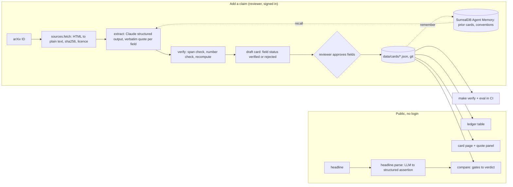

# Q-Day Ledger: architecture, verification, and evaluation

Status: build-ready draft, 2026-10-23. Read `CONTEXT.md` for the vocabulary and `docs/build/PRODUCT.md` for scope.

## 1. Shape

One Python service on Render. Cards live as JSON in the repo, so the deployed ledger is exactly the reviewed, versioned data. Model calls happen only when adding a claim or checking a headline.



The trust boundary: **the model never writes a number that reaches a published card without passing code checks and a human approval.**

## 2. Stack

| Layer | Choice | Why |
|---|---|---|
| Language and env | Python 3.12, `uv` | Severyn's daily stack |
| Web | FastAPI + Jinja2 templates + HTMX + one hand-written CSS file | One process; full control of the card design judges see; Clerk works through the same-origin `__session` cookie |
| Models | `claude-sonnet-5-5` via `client.messages.parse(output_format=PydanticModel)` for extraction and headline parsing; `claude-haiku-5-5` for repeated eval runs | Structured outputs return valid JSON. Citations cannot be combined with structured outputs (HTTP 400), so quotes are verified by our own code, which is the product's point (`build-feasibility.md` §1) |
| Source text | arXiv HTML (`arxiv.org/html/<id>`) converted to plain text; PDF text as fallback | Character offsets need plain text |
| Statistics | SciPy (`scipy.stats.beta`) | Clopper–Pearson intervals |
| Data | `data/cards/*.json`, `data/sources/*.json` in git | Render's disk is ephemeral; git gives versioning and review history |
| Memory (should) | SurrealDB Agent Memory, Python SDK `pip install --pre 'surrealdb[memory]'`, `infer="triples"` | Provenance graph and recall before extraction; matches SurrealDB's prize brief ("facts that supersede rather than overwrite", "retrieval you can trace back to its source") |
| Auth (should) | Clerk Hobby, `clerk-backend-api` | Reviewer sign-in; approval records `user_id` |
| Hosting | Render web service, `0.5c-512mb` paid plan ($7/month, covered by the $50 credit) | Free instances spin down after 15 minutes and take about a minute to wake; judges click cold links |

## 3. Data model

Pydantic models in `ledger/schema.py`. JSON on disk mirrors them.

```text
Source
  id                 "arXiv:2505.15917v1"
  title, authors[], date, url
  licence            "CC-BY-4.0" | "arXiv-nonexclusive" | "CC-BY-NC-SA-4.0" | "web-terms"
  text_sha256        hash of the plain text we checked against
  text_stored        true only if the licence allows redistribution

Quote
  text               verbatim span
  location           "p.12, Sec. 4.2" | "Table 5" | "line 1206"
  char_start, char_end   offsets into the source plain text (null for non-text sources)

Value
  number             float
  unit               "logical_qubits" | "physical_qubits" | "toffoli" | "t" | "toffoli_plus_half_t" | "hours" | "days" | "probability" | ...
  statistic          "worst_case" | "average_executed" | "expected" | "upper_bound" | "not_stated"
  kind               "observed" (read from a quote) | "derived" (computed from other fields)
  quote              Quote          (required when kind = observed)
  formula            str            (required when kind = derived, e.g. "toffoli * logical_qubits")

ClaimCard
  id                 "G25-RSA2048"
  source_id
  one_liner          plain-English summary
  target             { problem: "RSA-2048" | "ECDLP-secp256k1" | "ECDLP-P256" | "ECDLP-256-generic",
                       scope: "full_attack" | "point_addition" | "modular_inversion" | ... }
  layer              "logical_circuit" | "logical_algorithm" | "physical_architecture"
  metrics            { name: Value }      # logical_qubits, toffoli, physical_qubits, runtime, ...
  addend_interface   "classical" | "coherent" | "not_applicable" | "not_stated"
  amortization       "single_key" | "many_keys" | "not_stated"
  inclusions         [ "windowed_lookup", "coherent_addend_preparation", ... ]   # what the count includes; empty = not stated
  failure            { budget: Value?, observed_failures: int?, tests: int?, test_support: str, quote }
  hardware_assumptions [ { name, value: Value } ]   # physical layer only: error rate, cycle time, reaction time, code, runtime target
  counting_conventions [ Quote ]
  independent_verification { by, how, url } | null
  review             { status: "machine_extracted" | "human_reviewed" | "reproduced",
                       reviewer, reviewed_at, notes }
  checks             (written by the verifier, never by hand)

Headline                                   # a third-party restatement, not a claim
  id, text (verbatim), author, outlet, url, date
  asserted           { subject_card_ids[], metric, number, implied_layer, implied_scope, comparison }   # filled by headline.parse, confirmed by a human
  verdict            (written by compare, never by hand)
```

`checks` is regenerated by `make verify`; it is never edited by hand.

## 4. Verification: what "verifiable" means here

Each check is a pure function with unit tests. `make verify` runs all of them over every card and fails CI on any regression.

| Check | Rule | Example that must pass or fail |
|---|---|---|
| **Span check** | `quote.text` occurs in the source plain text (after whitespace normalisation); offsets match | Fails if the model paraphrases |
| **Number check** | The field's number can be parsed from its quote: handles `897,864`, `1.26e11`, `1.26 × 10^11`, `2^21.19`, `50 million`, `~1,200`, `under 1M` (flags inequality) | "50 million" in Litinski's title passes as a quote of the *title claim*; the single-key card must quote the (44 + 65/k)M formula |
| **Recompute** | Derived values recomputed from observed inputs; mismatch beyond tolerance → `source_inconsistency` flag (does not block publication; shown on the card) | Gidney 2025: 12.07 × 9.1 / 24 = 4.58 ≠ printed 4.63; 12.07 × 9.2 / 24 = 4.63 matches Table 5's 9.2 runs |
| **Failure statistics** | From `observed_failures / tests`: point estimate, 95 % Clopper–Pearson interval, P(clean run of n inputs) = (1 − p̂)^n, labelled "assumes independent, identically distributed trials; not a certificate" | 111 / 360,960 → p̂ = 3.075 × 10⁻⁴, CI [2.530, 3.703] × 10⁻⁴, (1 − p̂)^9024 = 0.062 |
| **Budget check** | Interval vs another benchmark's stated failure budget | The 893-qubit circuit's whole interval is above 2 × 10⁻⁴ (Gu et al.'s ≤ 20 per 100,000) |
| **Schema check** | Every observed value has a quote; every derived value has a formula; physical-layer cards list hardware assumptions | Blocks publication otherwise |

All key numbers above were recomputed independently with SciPy on 2026-10-23 and match `docs/research/build/claims-2026.md`.

**Tested on real papers (2026-10-23, `docs/research/build/span-check-feasibility.md`)**: 89 % of the classic corpus quotes match freshly extracted text (65 exact, 2 fuzzy, 8 misses); misses are table rows, Unicode formulas, and flattened superscripts. Therefore: one canonical text per source (normalised `pdftotext` or clean HTML, with sha256) that the extractor quotes from; a tiered span check (exact, then fuzzy where every digit must match in order; the card shows the tier and the source's own text); table values verified with a table locator against `pdftotext -layout` lines; and a number parser that recognises flattened exponents (`1.26 · 1011` means 1.26 × 10^11).

## 5. Comparability engine

`ledger/compare.py`: `compare(card_a, metric_a, card_b, metric_b) -> Verdict(level, gates[], sentence)`. Deterministic; no model.

| Gate | Passes when | On failure |
|---|---|---|
| G1 Problem | Same target problem | RSA vs ECC → **not comparable**. secp256k1 vs P-256 vs generic 256-bit → **caveat** ("different curve; secp256k1 admits cheaper formulas") |
| G2 Scope | Same scope (point addition vs full attack, etc.) and same inclusions (for example whether the windowed lookup is counted) | **not comparable** ("one excludes the windowed lookup") |
| G3 Layer | Same layer | **not comparable**, always. The engine never converts logical to physical |
| G4 Unit | Same gate unit | Toffoli vs T vs Toffoli + T/2 → **not comparable** ("no exact conversion; 4 to 7 T per Toffoli depending on construction") |
| G5 Statistic | Same statistic | Average executed vs worst case → **not comparable**. A measured value vs another claim's **upper bound** → **caveat**, one-sided ("at least X % below the stated bound; the bounded circuit may be smaller"). `not_stated` on either side → **caveat** |
| G6 Addend | Same addend interface (point addition only) | Classical vs coherent → **not comparable** ("coherent costs about 11 more qubits and about 30 % more Toffolis", ECDSA.Fail paper) |
| G7 Failure | Both exact, or failure budgets within 10× | **caveat**, naming both budgets |
| G8 Amortization | Same (single key vs many keys) | **not comparable** (Litinski's 50M is a many-key limit) |
| G9 Hardware | Physical layer only: same physical error rate, cycle time, reaction time, and runtime target | Same noise model but different error-correction construction → **caveat** (this is how Gidney compares his own 2019 and 2025 RSA estimates). Different error rate, cycle time, or runtime target → **not comparable**, listing the differing assumptions |

Verdict = **not comparable** if any gate fails hard; **comparable with caveat** if any caveat; **comparable** otherwise, in which case the page shows the ratio.

Labelled pairs live in `data/eval/pairs.json`; Severyn approves the labels **before** the engine is written. The 14 proposed pairs are listed in the T3 ticket (verdicts derived from the corpus files), for example: EF-893 vs EF-874 Toffolis (comparable); RNSL17 vs HJNRS20 logical qubits (comparable, both P-256); G25 vs GE19 physical qubits (caveat: same noise model, different construction); EF-BENCH coherent variant vs GOOG-ZK point-addition Toffolis (caveat, one-sided: 34.5 % below Google's bound); EF-893 vs GOOG-ZK (not comparable: classical vs window-indexed addend); PLDD-25 headline vs EF-893 (not comparable: layer and scope); LIT23 "50M" vs LIT23 single-key (not comparable: amortization); G25 vs GOOG-ZK logical qubits (not comparable: RSA vs ECC, the tracker confusion).

## 6. Extraction

`ledger/extract.py`:

1. `sources.fetch(arxiv_id)`: download HTML, convert to plain text, store `text_sha256`; cache text locally (gitignored) and commit it only if the licence allows.
2. Prompt: the schema, the counting-convention checklist (from `CONTEXT.md`), and, if memory is on, recalled conventions for the same source family. Instruction: every field needs a verbatim quote; write `not_stated` instead of guessing.
3. `client.messages.parse(model="claude-sonnet-5-5", output_format=CandidateCard, temperature=0)`.
4. Verifier runs; fields that fail span or number checks are marked `rejected` with the reason and never auto-filled.
5. Draft saved under `data/drafts/`; the reviewer page shows each field with its quote and status; approved fields are copied into a card with `review.status = human_reviewed`.

Logging: model id, prompt sha256, input/output tokens, cost, and latency per run in `data/runs/*.jsonl`.

Cost: about $0.08 input + $0.02 output per 40k-token paper on Sonnet 5.5 (`build-feasibility.md` §1); the whole hackathon needs well under $10 of model spend.

## 7. Headline check

`ledger/headline.py`: the model only **parses** the sentence into a structured assertion (subjects, metric, number, implied layer and scope, comparison direction). Mapping to cards is deterministic (identifier and alias table) and shown to the user for confirmation. The compare engine produces the verdict; the page quotes the cards. If no card matches, it says so.

## 8. Evaluation design

Purpose: answer Deval Pandya's question ("how do you know it is right?") with numbers, and show the gap to a plain chatbot.

**Gold data.** The two corpus files (`claims-classic.md`, `claims-2026.md`) were written by research agents with verbatim quotes and locations. Severyn reviews each card before it becomes gold. Gold is frozen in `data/eval/gold/` with a commit hash **before** prompt iteration starts.

**Split.**
- Dev (prompt iteration allowed): GE19-RSA2048, HJNRS20-P256, EF-BENCH.
- Held-out (run once, report as is): G25-RSA2048, SCHR, GOOG-ZK (all CC BY, so text can be cached for reproducibility).

**Metrics per held-out paper.**
- Field accuracy: exact match after normalisation for each numeric value + unit + statistic; categorical match for problem, scope, layer, addend, amortization.
- Quote validity: share of model quotes that pass the span check.
- Unsupported-number rate before the verifier (model output) and after (published draft); the second must be 0.

**Comparison baseline.** Twelve labelled comparison questions built from `pairs.json` ("Does the 893-qubit circuit need fewer qubits than Google's?", "Is Litinski's attack 50 million Toffolis?"). Ask the same model **without** the ledger (no tools, no documents), grade answers against the labels by a fixed rubric, and report how many conflate layer, scope, statistic, or amortization. Then run the ledger's engine on the same pairs. Report both, including any ledger failures.

**Reproducibility.** `scripts/run_eval.py --split heldout` writes `data/eval/results.json` with model id, prompt hash, date, scores, and every disagreement. The eval page renders that file; nothing on it is typed by hand.

## 9. Security and safety

- API keys only on the server; extraction and headline endpoints rate-limited; extraction requires sign-in; daily spend cap in code (`MAX_RUNS_PER_DAY`).
- Ingestion only from an allowlist (arXiv IDs, listed domains); no arbitrary URL fetching; no code execution from sources.
- No user data stored beyond reviewer ID on approvals.
- Content guardrails: public claims only, no circuits, no logical-to-physical conversion, "not independently verified" labels, corrections link.

## 10. Repository layout

```text
ledger/            schema.py  sources.py  verify.py  compare.py  extract.py  headline.py  memory.py
app/               main.py  templates/  static/
data/              sources/  cards/  drafts/  eval/{gold,pairs.json,questions.json,results.json}  runs/
scripts/           extract_card.py  run_eval.py  build_seed_cards.py
tests/             test_verify.py  test_compare.py  test_schema.py  test_cards.py
Makefile           verify, test, eval, run
render.yaml        service definition
```
